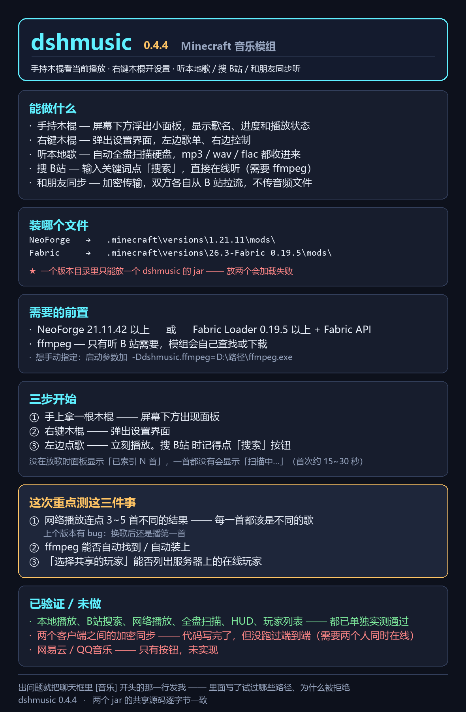

# dshmusic

> 在 Minecraft 里手持一根木棍就能听歌 —— 听硬盘上的、搜 B 站上的、和朋友同步听同一首。

支持 **1.21.11 (NeoForge)** 和 **26.3 (Fabric)**，两个版本的共享代码逐字节一致。



---

## 能做什么

| 功能 | 说明 |
|---|---|
| **手持木棍** | 屏幕下方浮出小面板，显示歌名、进度和播放状态 |
| **右键木棍** | 弹出设置界面：左边歌单、右边控制 |
| **听本地歌** | 自动全盘扫描硬盘，mp3 / wav / flac 全收进来 |
| **搜 B站** | 输入关键词点「搜索」，直接在线播放 |
| **和朋友同步** | 加密传输曲目信息，双方各自拉流，**不传音频文件** |
| **玩家列表** | 选择要同步给哪些玩家 |

---

## 安装

| 你玩的版本 | 需要 | 把哪个 jar 放进 mods |
|---|---|---|
| 1.21.11 | NeoForge 21.11.42+ | `dshmusic-0.4.4-NeoForge-1.21.11.jar` |
| 26.3 | Fabric Loader 0.19.5+ 和 Fabric API | `dshmusic-0.4.4-Fabric-26.3.jar` |

> ⚠️ 一个版本目录里**只能放一个** dshmusic 的 jar，放两个会加载失败。

**ffmpeg** 只有「听 B 站」需要，本地播放不需要。模组会自己按这个顺序找：

```
-Ddshmusic.ffmpeg=<文件或文件夹>      手动指定
  ↓
PATH 环境变量
  ↓
常见安装位置（8 个）
  ↓
后台 BFS 全盘搜索
  ↓
自动下载安装（约 28 MB）
```

**注意**：自动下载会先探测候选的 MP4 解复用能力 —— 精简版 ffmpeg 能运行但解不了 MP4，会被主动拒绝而不是留着后面报错。

---

## 怎么用

```
① 手上拿一根木棍 —— 屏幕下方出现面板
② 右键木棍 —— 弹出设置界面
③ 左边点歌 —— 立刻播放

   搜 B站：点「本地播放」切成「网络搜索」→ 输入关键词 → 点「搜索」按钮
```

详细图文教程见 [`docs/dshmusic-新手教程.docx`](docs/dshmusic-新手教程.docx)。

---

## 同步是怎么工作的

音频文件不走聊天（几 MB，聊天上限 256 字符），所以同步的**只有曲目身份和播放位置**：

```
发送方                                    接收方
  │
  ├─ {"v":1,"i":"net:BV1TVZXBqEaC","s":470,"t":...}
  │     AES-256-GCM 加密 → base64url → [DSHM]xxxxx
  │
  └─── /w <玩家> [DSHM]xxxxx ───────────►  解密
                                             │
                           ┌─────────────────┴─────────────────┐
                           │                                   │
                    是网络曲目（bvid）                  是本地文件（指纹）
                           │                                   │
                    自己去 B站 解析 cid                查自己的库里有没有
                    取流 → 下载 → 转换 → 播放                │
                                                  ┌────────┴────────┐
                                                  │                 │
                                               找到了           没找到
                                                  │                 │
                                            播自己的副本    用歌名去 B站 搜
                                                           按时长挑最接近的
                                                           下载 → 播放
```

**载荷格式**（加密前）：

```json
{"v":1,"i":"net:BV1TVZXBqEaC","n":"歌名","d":259,"s":470,"t":1699000000}
```

| 字段 | 含义 |
|---|---|
| `v` | 格式版本 |
| `i` | 曲目身份。`net:` = B站 曲目（后接 bvid）；16 位十六进制 = 本地文件指纹 |
| `n` | 歌名（仅本地文件载荷，用于对方找替代版本，截断 20 字符） |
| `d` | 时长秒数（仅本地文件载荷，用于挑时长最接近的替代） |
| `s` | 播放位置 × 10 |
| `t` | 发送时间戳（对方用它补偿消息延迟） |

**关于「加密」的诚实说明**：密钥硬编码在 jar 里，所以这是**混淆，不是安全边界** —— 拿到 jar 的人就能解密。真正起作用的是 GCM 认证标签：被篡改的消息会解密失败并被丢弃。

---

## 从源码编译

这个项目**不用 Gradle，也不用 Loom**。26.3 是去混淆的，所以直接对着原版 jar 用 `javac` 编译即可。

见 [`BUILDING.md`](BUILDING.md)。

---

## 项目结构

```
dshmusic/
├── common/          两个版本共享的源码（逐字节一致）
│   ├── Id3Reader.java        读 ID3 标签
│   ├── MusicLibrary.java     全盘扫描 + 时长过滤
│   ├── Mp3Player.java        播放 + 网络下载 + ffmpeg 转换
│   ├── ProviderSearch.java   B站 搜索 / 取流
│   ├── SyncChannel.java      同步载荷的组装与解析
│   ├── SyncCrypto.java       AES-256-GCM 封装
│   └── FfmpegInstaller.java  ffmpeg 下载与安装
├── neoforge/        1.21.11 的加载器接口（3 个文件）
├── fabric/          26.3 的加载器接口（3 个文件）
└── docs/            介绍卡 + 图文教程
```

---

## 已知限制

- **网易云 / QQ音乐** —— 只有按钮，未实现。这两家的曲库大部分需要会员，取流等于绕过访问控制，不做。
- **音频格式** —— 只支持 mp3 / wav / flac。`.m4a` 和 `.ogg` 解不了（Java Sound 的限制），网络音频是先转成 WAV 再播的。
- **本地文件同步** —— 需要双方都有那个文件，否则靠 B站 搜替代版本（按时长匹配，实测 4 个样本里 3 个差 0~1 秒）。

---

## 已验证 / 未验证

**已实测通过**：本地播放、B站 搜索、网络播放（0% 静音）、全盘扫描、HUD 渲染、玩家列表、双客户端端到端同步。

**未做**：网易云 / QQ音乐。

---

## 许可

MIT，见 [LICENSE](LICENSE)。

依赖的第三方库（编译时需要，未随仓库分发）：

- [JLayer](https://sourceforge.net/projects/javalayer/) (LGPL)
- [MP3SPI](https://sourceforge.net/projects/mp3spi/) (LGPL)
- [Tritonus](https://sourceforge.net/projects/tritonus/) (LGPL)
